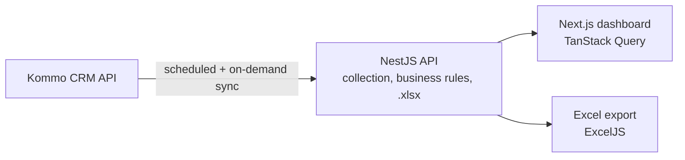

# Growth Analytics Dashboard — Case Study

> Internal growth dashboard I built for **Vale Verde Festas** with marketing campaign and messaging-blast metrics pulled from the Kommo CRM API.
> **Source code is private.** This repository documents the project; a live walkthrough is available on request.

## The problem

Marketing and sales leadership needed to see, in one place, how each campaign and each WhatsApp blast performed — leads, sources, conversions — without exporting data from the CRM by hand every week.

## What I built

- **Campaigns** and **Blasts** views with filters by period, campaign, source and blast.
- **Automatic refresh** every morning at 08:00 (Brasília) plus an on-demand "Refresh now".
- **Print** (A4 landscape) and **Export to Excel** — one sheet per view, only the filtered data.
- **Read-only by design**: the dashboard never writes back to the CRM.

## Architecture

- Business rules documented per column (where each number comes from).
- **Fake Kommo server** with invented data for local development and tests — no real customer data ever needed on a developer machine.
- Verification script that compares a real week against the expected counts (read-only).
- Secrets only in the server's `.env`, Argon2 password hashing.

## My role

Requirements with marketing and sales, data rules, API integration, UI, exports and tests.

---
Built by **Victor Sestrem** · [LinkedIn](https://www.linkedin.com/in/victor-sestrem/) · victor-sestrem@hotmail.com
